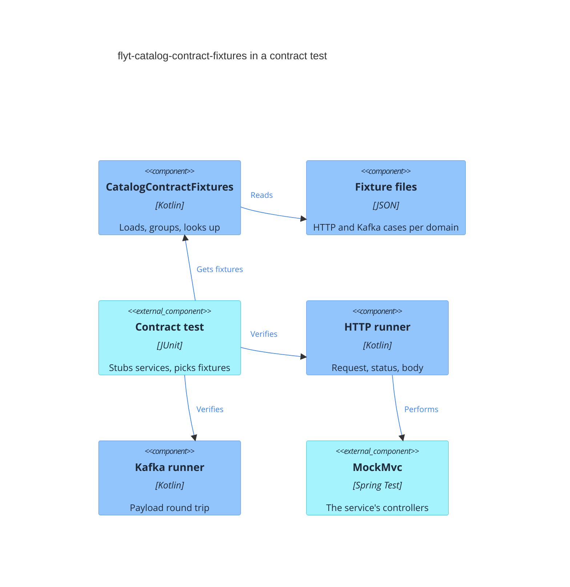

# Architecture

C4 level 3 for flyt-catalog-contract-fixtures. The library has no system context or containers of its own: it runs in
the contract tests of the service that depends on it, `fint-flyt-intgr-conf-service`. Blue is the library, turquoise is
the test and Spring's `MockMvc`.

## C4 level 3: Components

- **Fixture files** are in `src/main/resources/catalog-contract-fixtures/<domain>/{http,kafka}/` and ship in the jar.
- **`CatalogContractFixtures`** finds them on the classpath, checks that every id is unique, and returns them sorted by
  id, per domain, surface or contract.
- **`HttpContractFixtureRunner`** builds the request, sends it to the test's `MockMvc` and compares status, content type
  and body with JSONAssert. `ignoredPaths` are removed from both bodies first.
- **`KafkaPayloadFixtureRunner`** reads a payload into the type the test names and writes the value back, and compares
  the JSON strictly. Kafka itself is not involved.
- Both runners use **`FixtureObjectMapper`**, which builds the same `JsonMapper` as Spring Boot's auto-configuration,
  so dates and nulls are written as in production.
